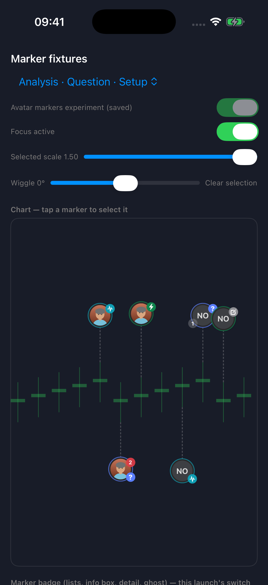
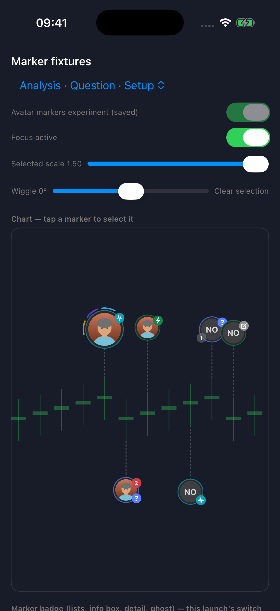
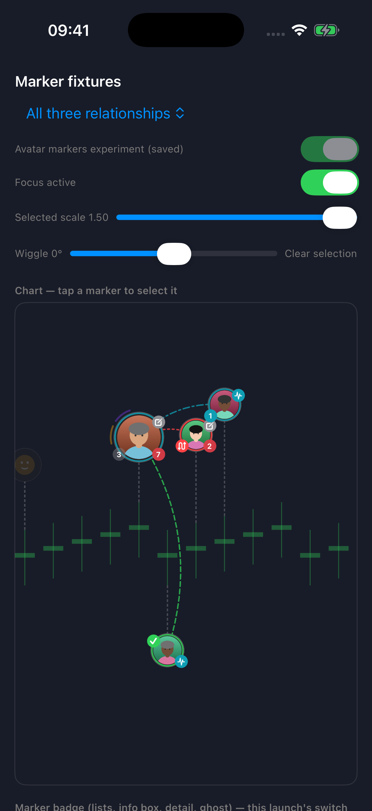
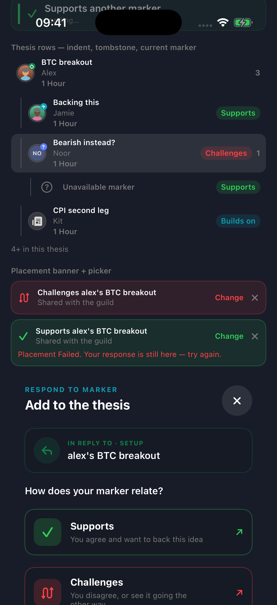
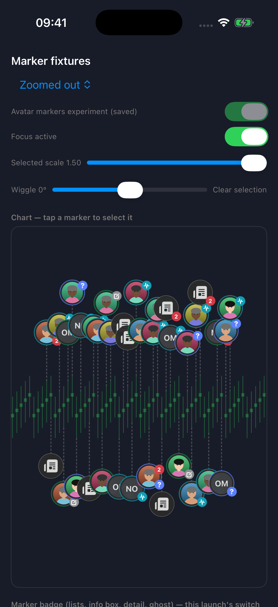

# v1.5.0 — Stage 2 owner visual review

**Approved by the owner on 2026-09-30. Stage 3 authorized.** The package below records the reviewed checkpoint; outstanding technical verification remains outstanding.

Review the avatar-led direction before Stage 3 changes creation. The frozen master plan remains `sanctuary/docs/version_docs/ios/1.5.0.md`.

Open [the visual gallery](visual-review/v1.5-owner-review.html). Captures are deterministic simulator fixtures through the app’s actual marker renderer, using synthetic portraits. They are not a live-data or physical-device acceptance result.

## Decision at this gate

Approve the visual direction, or identify changes to face prominence, intent/status badges, selected context arcs and relationship readability. The owner approved this gate on 2026-09-30. Density overlap is included explicitly for review; no new density strategy has been introduced.

## Engineering review

- Stage 1: author symbols are shared; selection scales continuously with upright clipped portraits. Directory identity takes precedence over historical snapshots, including explicit removal. Shared image loads are deduplicated; invalidated loads cannot repopulate either cache, and cancelled views do not publish results.
- Stage 2: Analysis, Question and Setup use author portraits behind the isolated DEV experiment. Existing Setup data and contracts remain intact. Relationship rings take precedence over intent rings. Selected arcs exclude structural levels, plain notes and emoji.
- Review corrections: cross-timeframe tethers clear the intent badge without moving jump badges or tap targets; thesis rows use author avatars with a neutral Setup badge where tracking state is absent.
- The production configuration cannot enable the experiment. Shared cache and avatar-foundation repairs are also present outside the experiment, so this is not a claim that production source is identical to 1.4.1.

## Evidence

Claude’s Stage 2 full suite passed 757 tests / 768 runs before the bounded corrections. The correction suite passed 96 tests / 108 runs, with zero failures or skips; Astra independently read the xcresult summary and preserved it in [test summary](visual-review/v1.5-stage2-correction-test-summary.json). Build evidence and exact artifact locations are recorded in the [Stage 2 checkpoint](V1_5_STAGE2_CHECKPOINT.md).

## Still unverified / known limits

- Live chart against real local DEV data; the backend was unavailable during this fixture checkpoint.
- Physical-device frame behavior, memory and cold/warm downloads; Stage 5 retains these checks.
- Theme, accessibility and full interaction acceptance remain later work.
- Existing adjacent-candle density overlap and the existing selection-neighbour overlap remain visible.
- Missing-image and failed-image initials still use two existing visual styles.
- Setup lifecycle is intentionally unknown in thesis previews, whose existing payload lacks tracking state.

No Stage 3 work, backend migration, Android v1.5 change, push, deployment or App Store submission is included.

## Selected visual evidence

### At rest

### Selected Analysis

### Focused branch

### Corrected thesis rows

### Density stress case

