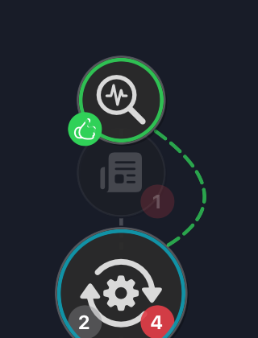
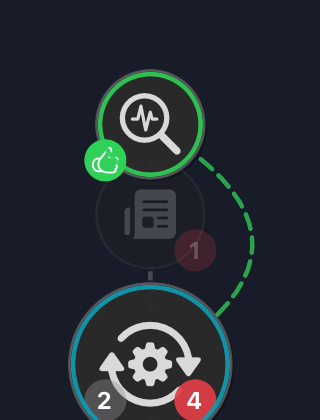
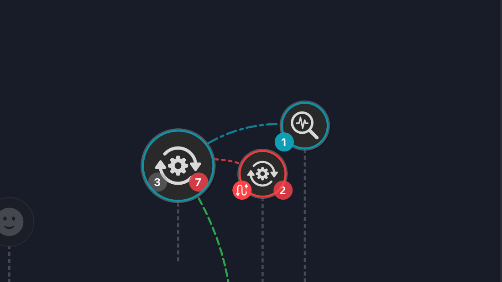

# Smoother marker connectors — 11 September 2026

User-requested polish implemented by Claude at `deb7b4f`, independently reviewed and integrated by Codex at `e94f5de`. Application and test sources match the tested Claude tree.

The renderer now emits one quadratic Bézier rather than 32 straight segments. Trimming preserves the original curve by adjusting its control point along with its endpoints. The smallest same-candle bow increases from 14 to 22 points to retain a rounded arc after trimming. Reveal animation follows the exact curve at every progress value.

The existing collision/badge checks, scaled marker boundaries, unsafe-route omission and 12-edge cap remain in force. Marker positions and the shared stack spine are unchanged. Cross-candle curves also benefit from the corrected trim; they look gentler rather than being pixel-identical to the earlier version.

## Visual comparison

Claude captured the fixture gallery; Codex inspected both comparison pairs and the full three-relationship view. The stacked curve has a smooth sweep and stays clear of the faded unrelated glyph. The cross-candle relationships remain legible with their distinct dash patterns.

| Before | After |
| --- | --- |
|  |  |
|  |  |

## Verification

- Independently inspected `scratchpad/curve-units2.xcresult`: **605 passed, 0 failed, 0 skipped** (`test-summary.json`).
- Tests cover true subcurve geometry, close selected stacks, intervening glyph/badge clearance, chart bounds, unsafe omission, emitted quadratic path elements and exact partial-reveal endpoints.
- Simulator test builds passed (`curve-build1/2/3.log`); optimized DevProfile build passed (`curve-devbuild.log`). Logs remain in Claude's scratchpad alongside the source images recorded in `evidence.json`.
- This polish does not close the remaining physical performance or manual VoiceOver release gates. The earlier production Release artifact predates this curve change; rebuild from the feature project for the updated app.
